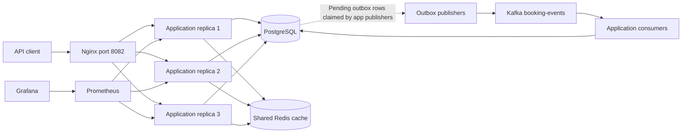
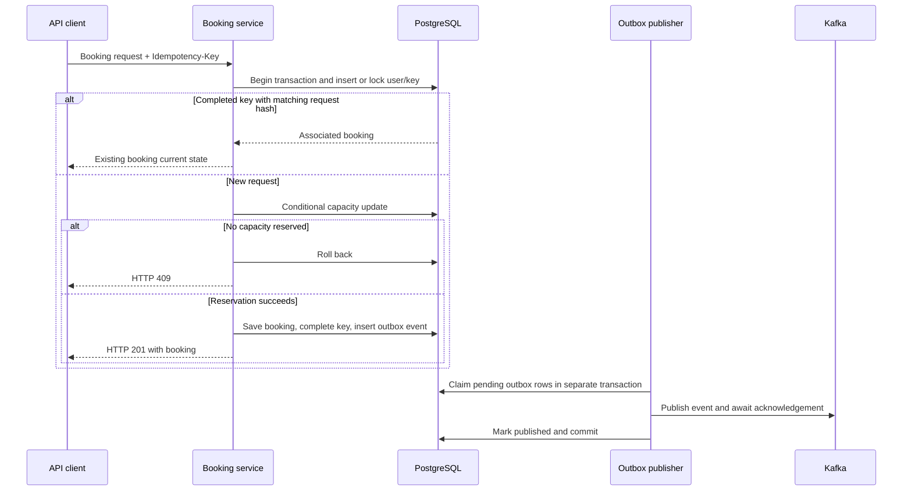
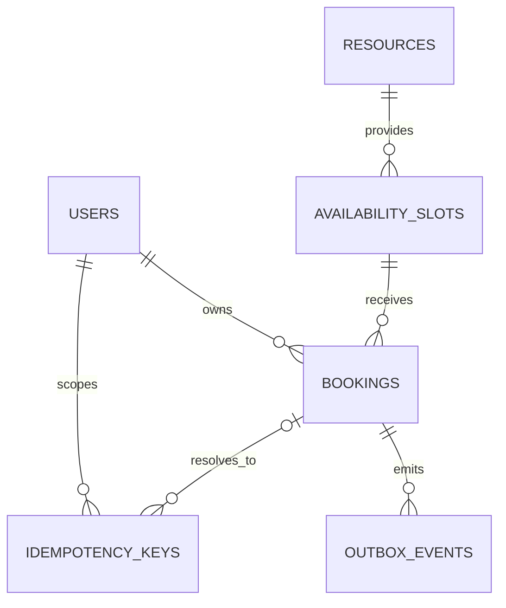

# Distributed Resource Booking System

**Reserve limited inventory safely across multiple backend replicas.**

**Java 21 · Spring Boot 4.1.1 · PostgreSQL · Redis · Kafka · Docker · Nginx**

A backend project that solves three real booking problems: competing requests for the last available unit, duplicate bookings when a client retries, and events that never get published after a booking commits. It uses atomic database reservations, transactional idempotency, and a transactional outbox, running as three replicas behind Nginx.

## The problem

A booking is more than a database insert. A read-then-update can oversell the last unit. A client retry after a lost response can create a second booking. A crash between the booking commit and the event publish can leave downstream systems uninformed.

| Problem | How it's handled |
| --- | --- |
| Two requests racing for the last unit | Conditional capacity update inside one transaction — no read-check-write race |
| A retry creating a duplicate | User-scoped idempotency key + request hash; same key + same request returns the original booking |
| A booking that commits but its event never publishes | Booking and outbox event saved in the same transaction; a publisher relays them to Kafka |
| Competing cancellations | Booking row lock (`FOR UPDATE`); capacity restored with an upper-bound check |
| Repeated event delivery | Consumer deduplicates by event ID |

**Scope:** backend APIs and distributed coordination for capacity-based slots. No frontend, payments, assigned seats, or route segments.

## Tech stack

| Layer | Technology |
| --- | --- |
| Language / framework | Java 21, Spring Boot 4.1.1 (Spring MVC, Spring Data JPA) |
| Database | PostgreSQL — the single authority for capacity |
| Cache | Redis (resource lists, 60s TTL) |
| Messaging | Apache Kafka (Spring Kafka) — booking events via a transactional outbox |
| Deployment | Docker Compose, Nginx (3 app replicas, port 8082) |
| Observability | Actuator, Micrometer, Prometheus, Grafana |
| Tests / build | JUnit, Mockito, Maven Wrapper |

Passwords are BCrypt-hashed. There is no login endpoint or per-user authorization yet — that's the next step (see [What's next](#whats-next)).

## Architecture



PostgreSQL decides whether a booking succeeds; Redis and Kafka never do. The publisher and consumer run inside the app replicas, not as separate services.

### How a booking works

1. The request must carry an `Idempotency-Key` header (1–200 chars).
2. The key is locked per user and a SHA-256 hash of user + slot + quantity is compared. A completed key with a matching hash returns the original booking; the same key with different details is rejected (HTTP 409).
3. Capacity is decremented only when the slot is `AVAILABLE` and enough units remain — one conditional `UPDATE`, so the check and the decrement can't race.
4. The `CONFIRMED` booking, the completed idempotency record, and a `BOOKING_CREATED` outbox event are saved in one transaction.
5. A publisher claims up to 100 pending outbox rows (`FOR UPDATE SKIP LOCKED`, 5s delay), sends them to Kafka, and marks them published. The consumer deduplicates by event ID.

Cancellation locks the booking, restores capacity (never above the slot's capacity), marks it `CANCELLED`, and writes a `BOOKING_CANCELLED` outbox event — all in one transaction. Cancelling twice returns a conflict.



### Design notes

- **Atomic reservation** — the reservation is a single conditional `UPDATE` that also flips the slot to `FULL` when capacity hits zero. The service checks the affected-row count: zero rows means no reservation. ([BookingService](src/main/java/com/resourcebooking/booking/service/BookingService.java), [AvailabilitySlotRepository](src/main/java/com/resourcebooking/booking/repository/AvailabilitySlotRepository.java))
- **Idempotency** — keys are scoped by `(user_id, key)` with a database unique constraint and row locking.
- **Outbox** — booking and event intent commit together, so a crash can't lose the event. Delivery is at-least-once, not exactly-once, and per-booking ordering isn't guaranteed.
- **Tradeoffs** — conditional updates can contend on hot slots; the outbox adds polling lag and duplicate handling; three replicas help the app layer, but PostgreSQL and the single Kafka broker are still shared dependencies.

## Data model



| Table | Holds |
| --- | --- |
| `users` | User details, BCrypt password hashes, status |
| `resources` | Resource metadata, capacity, type ID |
| `availability_slots` | Time window, capacity, available capacity, status |
| `bookings` | Reference, user, slot, quantity, status |
| `idempotency_keys` | User/key uniqueness, request hash, linked booking, expiry timestamp |
| `outbox_events` | Event ID, aggregate reference, JSON payload, publication status |
| `processed_events` | Event-ID deduplication records |

## Results

Load-tested with JMeter 5.6.3 (through Nginx, port 8082). Full plans, raw files, and screenshots: [docs/results](docs/results/).

**Reads** — `GET /api/slots/resource/1`

| Workload | Requests | Throughput | p95 | Errors |
| --- | ---: | ---: | ---: | ---: |
| 10 users, 60 s | 8,186 | 136.3 req/s | 111 ms | 0% |
| 50 users, 60 s | 9,717 | 161.3 req/s | 246 ms | 0% |
| 100 users, 120 s | 24,893 | 206.2 req/s | 1,208 ms | 0% |

**Booking contention** — 5,000 requests (500 threads × 10) against a 100-unit slot: exactly **100 confirmed bookings, zero overselling**, slot ended `FULL` with 0 remaining. The other 4,900 requests were turned away once the 100 units were gone.

**Functional checks** — same-key retry returned the same booking both times; cancellation restored capacity 9 → 10; Nginx logs show traffic on all three replicas; 100 sequential reads succeeded after one replica was stopped; the Kafka consumer received the published events.

These are results from the documented local workloads, not a claim about maximum capacity.

## Run it locally

**Prerequisites:** Docker Desktop (Linux engine), Java 21 (JDK), Git, PowerShell 7 (the verification scripts are PowerShell). Free local ports: `8082`, `55432`, `16379`, `19092`.

```sh
git clone https://github.com/Shashivardhan2710/Distributed_resource_booking_system.git
cd Distributed_resource_booking_system
./mvnw.cmd -B -DskipTests package
```

Then start the full stack (PostgreSQL 16, Redis 7, Kafka, Nginx + 3 app replicas). The [local-verification](local-verification/) folder has the ready-made Compose setup plus scripts that build fixtures, run the JUnit suite, and re-run the JMeter loads:

```sh
cd local-verification
python prepare_environment.py
docker compose -p booking-evaluation -f compose.local.json up -d --build
./wait-ready.ps1
./functional-checks.ps1
```

The API is on `http://localhost:8082`. Stop with `docker compose -p booking-evaluation -f compose.local.json stop`.

## API

| Method | Path | Purpose |
| --- | --- | --- |
| POST | `/api/users` | Register a user (BCrypt-hashed password) |
| POST | `/api/resources` | Create a resource |
| GET | `/api/resources` | List resources (Redis cache, 60s TTL) |
| POST | `/api/slots` | Create an availability slot |
| GET | `/api/slots/resource/{resourceId}` | List slots for a resource |
| POST | `/api/bookings` | Create a booking — requires `Idempotency-Key` |
| GET | `/api/bookings/{bookingId}` | Read a booking |
| GET | `/api/bookings/user/{userId}` | A user's booking history |
| POST | `/api/bookings/{bookingId}/cancel` | Cancel a confirmed booking |
| GET | `/api/health`, `/actuator/health`, `/actuator/prometheus` | Health and metrics |

```sh
# create a user and a resource
curl -X POST http://localhost:8082/api/users -H 'Content-Type: application/json' \
  -d '{"name":"Demo User","email":"demo@example.com","password":"DemoPassword123!"}'
curl -X POST http://localhost:8082/api/resources -H 'Content-Type: application/json' \
  -d '{"resourceTypeId":1,"name":"Meeting Room A","description":"Demo room","capacity":4,"location":"Floor 1"}'

# create a slot (use a future date-time; the API takes LocalDateTime)
curl -X POST http://localhost:8082/api/slots -H 'Content-Type: application/json' \
  -d '{"resourceId":1,"startTime":"2030-01-15T10:00:00","endTime":"2030-01-15T11:00:00","capacity":4,"availableCapacity":4}'

# book it (retrying the same key returns the same booking)
curl -X POST http://localhost:8082/api/bookings -H 'Content-Type: application/json' \
  -H 'Idempotency-Key: demo-booking-001' \
  -d '{"userId":1,"slotId":1,"quantity":1}'

# read and cancel
curl http://localhost:8082/api/bookings/1
curl -X POST http://localhost:8082/api/bookings/1/cancel
```

Success: booking creation returns `201` (including a successful replay), reads and cancellation return `200`. Sold-out slots and key conflicts return `409`, validation errors `400`, missing bookings `404`. A booking response includes `id`, `bookingReference`, `userId`, `slotId`, `quantity`, `status`, and `createdAt`.

## Tests

| Suite | Covers |
| --- | --- |
| `UserServiceTest` | Password hashing, duplicate-email rejection |
| `BookingConcurrencyTest` | Two contenders for the last unit, final DB state |
| `ResourceBookingApplicationTests` | Application context loads |
| `RedisCacheConfigTest` | Resource DTOs survive a cache round trip |

Run them with `./run_junit.ps1` in `local-verification/` (needs the services up and fixture users present). Expect 5 tests, 0 failures.

## Observability

Micrometer tracks booking requests, successes, failures, idempotent retries, and processing time; Prometheus scrapes each replica; Nginx access logs show which replica served each request.

## Project layout

```text
src/main/java/com/resourcebooking/booking/
  config/       Cache, Kafka, password, and JSON setup
  controller/   REST endpoints
  dto/          Request validation and response models
  entity/       Persistence models and status enums
  event/        Kafka consumer and cache invalidation
  exception/    Exceptions and HTTP error mapping
  repository/   Queries, conditional updates, and locks
  service/      Booking orchestration and outbox publisher
src/main/resources/application.properties
src/test/java/com/resourcebooking/booking/
docs/results/   JMeter plans, raw results, screenshots, test notes
local-verification/  Compose setup and test/load scripts
monitoring/prometheus.yml
nginx/nginx.conf
compose.yaml
Dockerfile
pom.xml
```

## What's next

- **Authentication & ownership** — JWT login + Spring Security; users see/cancel only their own bookings, plus an admin role.
- **Idempotency expiry** — expiry is stored but not enforced; add retention and a cleanup job.
- **Event ordering** — per-booking sequencing, retry isolation, replay, and backlog alerts.
- **Booking rules** — overlap checks, active-status and cutoff enforcement, and a cleaner policy for cancelling blocked/closed slots.
- **Timezones** — slots use `LocalDateTime`; move to `OffsetDateTime`.
- **CI + API docs** — GitHub Actions and an OpenAPI/Swagger contract.
- **Failure testing** — broker/database outage and in-flight crash recovery.

## Team

| Member | Roll no. |
| --- | --- |
| B Revanth Kumar | 202451030 |
| J Shashivardhan | 202451082 |
| K Yuvaraju | 202452325 |

**Mentor:** Dr. Bhupendra Kumar

## References

- [Spring transactions](https://docs.spring.io/spring-framework/reference/data-access/transaction.html)
- [PostgreSQL transaction isolation](https://www.postgresql.org/docs/current/transaction-iso.html)
- [Spring for Apache Kafka](https://docs.spring.io/spring-kafka/reference/)
- [Transactional outbox pattern](https://microservices.io/patterns/data/transactional-outbox.html)
- [Apache JMeter](https://jmeter.apache.org/usermanual/index.html)

## License

No license yet — contact the maintainers about reuse.
